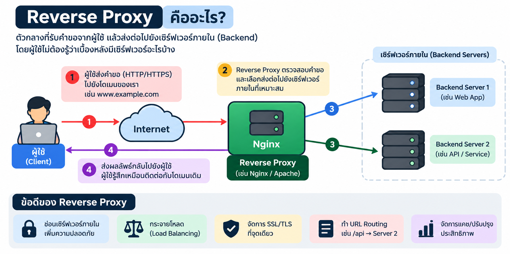
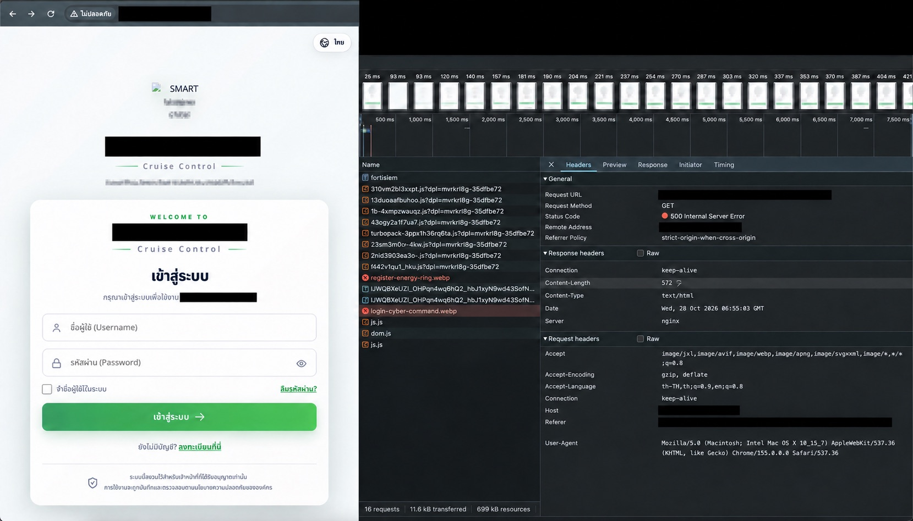

# Nginx Reverse Proxy Setup Wizard

สคริปต์ Bash แบบโต้ตอบสำหรับติดตั้ง Nginx (หากยังไม่มี) และสร้าง reverse proxy configuration สำหรับเว็บหลักกับเว็บเพิ่มเติมที่เผยแพร่ใต้ path เช่น `/report/` หรือ `/admin/` เหมาะกับเครื่อง Linux ที่ใช้ `systemd` และรองรับการติดตั้งอัตโนมัติบน Ubuntu/Debian และตระกูล RHEL ที่ระบุในสคริปต์



*ภาพรวมแนวคิด Reverse Proxy; ภาพนี้อธิบายความสามารถทั่วไป เช่น Load Balancing ซึ่งสคริปต์ชุดนี้ไม่ได้ตั้งค่าให้โดยอัตโนมัติ*

> อ่านสคริปต์และตรวจค่าที่จะกรอกก่อนรันบนเครื่องจริง สคริปต์ทำงานด้วยสิทธิ์ root และแก้ไขการตั้งค่า Nginx รวมถึงอาจปรับ firewall/SELinux ตามสภาพแวดล้อม

## ความสามารถ

- ติดตั้ง Nginx และเครื่องมือดูพอร์ตเมื่อยังไม่มี
- เลือก Cloudflare/Tunnel, HTTP หรือ HTTPS ที่ Nginx; โหมด HTTPS จะค้นหา certificate ที่ตรงกับโดเมนในตำแหน่งมาตรฐานให้อัตโนมัติ
- ตั้งค่า upstream หลัก และเว็บเพิ่มเติมใต้ subpath ได้สูงสุด 20 เว็บ
- ส่งต่อ WebSocket และ forwarding headers พร้อมเปิด TLS SNI สำหรับ upstream HTTPS
- สร้าง alias สำหรับ base path ของ upstream และ route browser assets โดยดู `Sec-Fetch-Dest` พร้อม fallback จากนามสกุลไฟล์ จึงไม่ต้องระบุชื่อโฟลเดอร์หรือชื่อรูปไว้ล่วงหน้า
- เพิ่ม path override สำหรับไฟล์/API ที่ต้องส่งไปยังเว็บปลายทางเจาะจงได้จาก Wizard เช่น `/assets/` หรือ `/logo.webp`
- สำรอง reverse proxy config เดิมก่อนแทนที่ และทดสอบด้วย `nginx -t` ก่อน reload
- เปิดเฉพาะพอร์ตที่เลือกใน UFW/firewalld เมื่อ firewall นั้นเปิดใช้อยู่แล้ว โดยไม่เปิด firewall ให้เอง
- รองรับการตั้งค่า SELinux เบื้องต้นเมื่อพบเครื่องมือที่เกี่ยวข้อง

## ข้อกำหนด

- Linux ที่ใช้ `systemd`
- รันด้วย `sudo` หรือ root
- ติดตั้ง Nginx เองหรือใช้ระบบติดตั้งอัตโนมัติของสคริปต์บน Ubuntu/Debian, Linux Mint, Pop!_OS และตระกูล RHEL ที่รองรับ (เช่น AlmaLinux, Rocky Linux, RHEL, CentOS, Fedora, Oracle Linux)
- upstream ของแต่ละเว็บต้องเข้าถึงได้จากเครื่อง Nginx และต้องชี้ไปยังแอปหลังบ้าน ไม่ใช่ IP/พอร์ตรับเว็บของ Nginx เอง
- DNS/Cloudflare/Tunnel และ TLS certificate ต้องเตรียมตามรูปแบบที่เลือก

สคริปต์ไม่รองรับการติดตั้งอัตโนมัติบน Linux distribution อื่น แต่ถ้ามี Nginx และ `systemd` อยู่แล้ว อาจใช้งานได้หลังตรวจสอบ environment ด้วยตนเอง

## ติดตั้งและเริ่มใช้งาน

ดาวน์โหลด repository แล้วเข้าโฟลเดอร์สคริปต์:

```bash
git clone https://github.com/saranse/nginx-reverse-proxy-wizard.git
cd nginx-reverse-proxy-wizard
chmod +x setup_reverse_proxy.sh
sudo ./setup_reverse_proxy.sh
```

สคริปต์จะถามข้อมูลทีละข้อ หากกด Enter จะใช้ค่าเริ่มต้นที่แสดงในวงเล็บเหลี่ยม/ท้าย prompt

ก่อนเริ่มถามค่า สคริปต์จะตรวจคอนฟิก Nginx ปัจจุบันด้วย `nginx -T` และสรุปไฟล์ที่เปิดใช้งาน, `listen`, `server_name`, `location`, `proxy_pass` และ upstream servers เพื่อให้ตรวจ routing เดิมก่อนเปลี่ยนค่า หาก config syntax ไม่ผ่าน จะแสดง routing directives จากไฟล์ที่ wizard จัดการแทน

## ค่าที่ต้องเตรียม

1. **โดเมนหน้าเว็บ** เช่น `app.example.com`
2. **รูปแบบการเชื่อมต่อเข้า Nginx**
   - ตัวเลือก 1: ผู้ใช้เข้า HTTPS ผ่าน Cloudflare WAF/Tunnel แล้ว Tunnel ส่ง HTTP มาที่ Nginx พอร์ต 80 (ค่าเริ่มต้น)
   - ตัวเลือก 2: HTTP เข้า Nginx พอร์ต 80
   - ตัวเลือก 3: Nginx รับ HTTPS ที่พอร์ต 443; สคริปต์ค้นหา certificate/key ของโดเมนให้อัตโนมัติ หากไม่พบจึงให้ระบุพาธเอง
   - ตัวเลือก 4: HTTP บนพอร์ตอื่น เช่น 8080; ใช้เมื่อ Tunnel หรือระบบด้านหน้าส่งมายังพอร์ตนั้น
3. **Upstream หลัก** เช่น `http://127.0.0.1:3000/` หรือ `http://127.0.0.1:3000/app/`
4. **เว็บเพิ่มเติม** (ถ้ามี): path ภายนอก เช่น `report` และ URL ต้นทาง เช่น `http://192.0.2.20:8080/remote/`
5. **Upstream ของเว็บหลัก** ต้องเป็น IP/พอร์ตของแอปหลังบ้าน เช่น `http://127.0.0.1:3000/`; อย่าใส่ URL หน้าเว็บของ Nginx เอง เพราะจะเกิดการวนกลับ

ใส่ upstream ในรูปแบบ `http://host[:port][/base/path/]` หรือ `https://host[:port][/base/path/]` ห้ามมี query string หรือ fragment (`?` หรือ `#`). ตัวอย่าง IP ในเอกสารนี้ใช้ช่วงที่สงวนไว้สำหรับตัวอย่างเท่านั้น

## ตัวอย่างการตั้งค่า

สมมติว่า:

- โดเมน: `app.example.com`
- เว็บหลักอยู่ที่ `http://127.0.0.1:3000/`
- เว็บรายงานต้องแสดงที่ `/report/` และต้นทางอยู่ที่ `http://192.0.2.20:8080/remote/`

เลือกตัวเลือก 1, ใส่ upstream หลักตามตัวอย่าง, จำนวนเว็บเพิ่มเติมเป็น `1`, แล้วกรอก path `report` กับ upstream ของเว็บรายงาน จากนั้นยืนยันตัวเลือก asset routing ตามความเหมาะสมกับแอป

ถ้าไฟล์บางรายการยังถูกส่งไปผิดเว็บ ให้ดู URL ที่ล้มเหลวใน Browser DevTools → Network แล้วเพิ่ม path override ใน Wizard:

1. ใส่จำนวน path ที่ต้องการเพิ่ม
2. กรอก path ที่ browser เรียก เช่น `/assets/` สำหรับทั้งโฟลเดอร์ หรือ `/logo.webp` สำหรับไฟล์เดียว
3. เลือกหมายเลขเว็บปลายทางจากรายการที่ Wizard แสดง

path ที่ลงท้ายด้วย `/` จะครอบคลุมทุกไฟล์ใต้โฟลเดอร์นั้น ส่วน path ที่ไม่มี `/` ท้ายจะจับเฉพาะ URL นั้น การตั้งค่านี้เป็นการกำหนดเส้นทางใน Nginx ไม่ใช่การเปิดพอร์ต firewall

### เพิ่ม path ภายหลังด้วยสคริปต์แยก

หลังตั้งค่าด้วย Wizard รุ่นที่มี marker สำหรับ asset path แล้ว สามารถเพิ่ม route ทีละรายการโดยไม่ต้องตอบคำถามตั้งค่าทั้งหมด:

```bash
chmod +x add_asset_path.sh
sudo ./add_asset_path.sh
```

กรอก path จาก Browser DevTools → Network แล้วกรอก upstream URL ของเว็บปลายทาง สคริปต์จะสำรอง `/etc/nginx/conf.d/reverse_proxy.conf`, เพิ่ม route, ตรวจ `nginx -t` และ reload Nginx หากตรวจไม่ผ่านจะคืนไฟล์เดิม ใช้กับ config เดิมที่ Wizard สร้างได้โดยไม่ต้องตั้ง Wizard ใหม่ ส่วน config ที่มีหลาย `server` block จะหยุดไว้ให้ตรวจเอง การรัน Wizard รอบถัดไปจะสร้าง config ใหม่และเก็บ config ก่อนหน้าไว้ใน backup

**สำคัญ:** URL ที่กรอกต้องเป็น URL ภายในของ backend ที่ตอบ resource นี้จริง เช่น ถ้า browser ขอ `/siem/logo.webp` และ backend ให้ไฟล์นี้ที่ `http://10.0.0.25:3000/siem/logo.webp` ให้กรอก URL backend ดังกล่าว อย่ากรอก URL หน้าเว็บ Nginx เช่น `http://app.example.com/siem/logo.webp` เพราะจะ proxy วนกลับเข้า Nginx และอาจเกิด `500` หรือ redirect loop สคริปต์จะปฏิเสธ upstream ที่ host ตรงกับ `server_name` ของ config นี้ แต่ควรตรวจว่า IP/โดเมน backend เป็นปลายทางภายในจริงด้วย

สำหรับ path แบบไฟล์เดียว เช่น `/siem/logo.webp` ให้กรอก URL backend ที่มี path ของไฟล์ครบ ส่วน path แบบโฟลเดอร์ เช่น `/assets/` ให้กรอก URL base path ของ backend ที่ลงท้ายด้วย `/` เช่น `http://10.0.0.25:3000/assets/` เพื่อให้ path ใต้โฟลเดอร์ถูกส่งต่อได้

ถ้าเข้า shell เป็น root อยู่แล้ว ให้รัน `./add_asset_path.sh` โดยไม่ต้องเติม `sudo`; ถ้าเข้าเป็นผู้ใช้ทั่วไปให้ใช้ `sudo ./add_asset_path.sh` หลังแก้ config เอง หากเป็น root ให้ตรวจและ reload ด้วย `nginx -t && systemctl reload nginx`.

ถ้าใช้ Cloudflare Tunnel ให้กำหนด service ของ ingress เป็น `http://127.0.0.1:80` และ restart `cloudflared` หลังตั้งค่าเสร็จ DNS ของโดเมนต้องชี้เข้าระบบที่ให้บริการด้วย

## ไฟล์และการสำรองค่า

สคริปต์สร้างหรือแทนที่:

- Nginx config: `/etc/nginx/conf.d/reverse_proxy.conf`
- สำเนา config เดิม: `/etc/nginx/backup/reverse_proxy.conf.<วันที่-เวลา>.bak`

ก่อนแทนที่ไฟล์เดิม สคริปต์จะสำรองไว้ และจะคืนค่า config เดิมหาก `nginx -t` ไม่ผ่าน จากนั้นจึง enable และ reload/start Nginx

หากต้องแก้ Nginx config ด้วยตนเอง ให้เปิดไฟล์นี้:

```bash
sudo nano /etc/nginx/conf.d/reverse_proxy.conf
```

หลังบันทึก ให้ตรวจ syntax และ reload Nginx:

```bash
sudo nginx -t && sudo systemctl reload nginx
```

การรัน wizard รอบถัดไปจะสร้าง `reverse_proxy.conf` ใหม่ โดยเก็บสำเนาเดิมไว้ใน `/etc/nginx/backup/`

หากเลือก purge Nginx เดิม สคริปต์จะขอให้พิมพ์ `PURGE NGINX` เพื่อยืนยัน และสำรอง `/etc/nginx` ไว้ใต้ `/root/nginx-backups/` ก่อนถอนแพ็กเกจและลบ `/etc/nginx` การ purge อาจกระทบ virtual hosts และค่าปรับแต่งเดิมทั้งหมด อ่านผลกระทบและเก็บสำรองไว้นอกเครื่องก่อนยืนยัน

## จัดการ Nginx service

ใช้ `systemctl` เพื่อควบคุม service ของ Nginx:

```bash
sudo systemctl start nginx    # เริ่ม service
sudo systemctl stop nginx     # หยุด service
sudo systemctl status nginx   # ดูสถานะ service
sudo systemctl restart nginx  # หยุดแล้วเริ่ม service ใหม่
```

หลังแก้ configuration แนะนำให้ตรวจ syntax ก่อน แล้วจึง reload เพื่อให้ Nginx โหลดค่าใหม่โดยไม่หยุดรับคำขอ:

```bash
sudo nginx -t
sudo systemctl reload nginx
```

## ตรวจสอบและแก้ปัญหา

ตัวอย่างหน้าจอ Network ที่ปิดข้อมูลระบุตัวตนแล้ว โดยยังแสดงชื่อ resource และ status ที่ใช้ตรวจสอบ:



```bash
sudo nginx -t
sudo systemctl status nginx --no-pager
sudo journalctl -u nginx -n 50 --no-pager
sudo ss -ltnp
```

- หากเห็น `502 Bad Gateway` ให้ตรวจว่า upstream ทำงานและเข้าถึงได้จากเครื่อง Nginx
- หากเว็บใต้ path โหลด CSS/JS/รูปไม่ครบ ให้เปิด Browser DevTools → Network แล้วดู URL, status และ initiator ของรายการที่ล้มเหลว สคริปต์ route browser assets โดยอัตโนมัติจาก `Sec-Fetch-Dest` และนามสกุลไฟล์ หากตรวจพบว่า path ถูกส่งไปผิดเว็บ ให้เพิ่ม path override ใน Wizard ตามหัวข้อด้านบน หรือแก้ Nginx config ที่ `/etc/nginx/conf.d/reverse_proxy.conf`
- ถ้ารายการล้มเหลวตอบ `404` ให้เทียบ URL เดียวกันกับ upstream โดยตรง เพื่อตรวจ base path และปลายทางที่ถูกต้อง ถ้าตอบ `500` แปลว่าคำขอไปถึงเซิร์ฟเวอร์แล้ว ให้ตรวจ log ของแอป/upstream ก่อน เพราะการเพิ่ม path route ไม่ได้แก้ข้อผิดพลาดภายในแอปโดยอัตโนมัติ
- หากพอร์ตถูกใช้งานอยู่ ให้เลือกพอร์ต Nginx อื่นหรือจัดการ service ที่ครอบครองพอร์ตนั้นก่อน
- หากเปิด HTTPS ที่ Nginx ตรวจว่า certificate/key ถูกต้องและอ่านได้ รวมถึง certificate ตรงกับโดเมน
- หากใช้ SELinux แล้ว proxy ไป upstream ไม่ได้ ให้ตรวจ boolean `httpd_can_network_connect` และสิทธิ์พอร์ตของ SELinux
- ตรวจให้แน่ใจว่า firewall และระบบ Cloudflare/Tunnel อนุญาตพอร์ตที่เลือก

## ความปลอดภัยและขอบเขต

- สคริปต์แก้เฉพาะไฟล์ `/etc/nginx/conf.d/reverse_proxy.conf` ในการตั้งค่าปกติ แต่การเลือก purge มีผลกว้างตามที่อธิบายข้างต้น
- สคริปต์ไม่สร้าง certificate ให้ และไม่เปิดใช้งาน firewall เอง
- ค่า `X-Forwarded-*`, Host header และการ route ไฟล์ตาม Referer อาจต้องปรับให้เหมาะกับแอปและโครงสร้างเครือข่ายจริง
